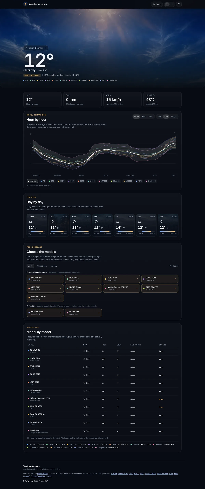
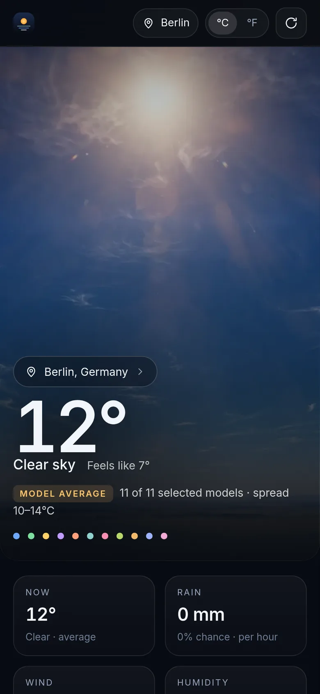

# Weather Compare

Global weather models disagree. This app shows the disagreement: forecasts from
**11 independent models** side by side, plus a plain average across the models you
select — every line attributable, every gap visible.

One static web app. No backend, no API key, no tracking. Works on a desktop browser
and installs as a PWA on a phone.

Source: <https://github.com/ArndRosemeier/Weather>



## Why these models

A provider re-packaging the same base model is not a second opinion. The catalogue
keeps exactly **one entry per base model** and documents every exclusion:

| Base model | Provider | Type | Typical horizon |
| --- | --- | --- | --- |
| ECMWF IFS | ECMWF | physics | 15 d |
| ECMWF AIFS | ECMWF | AI | 15 d |
| NOAA GFS | NOAA NCEP | physics | 16 d |
| GraphCast | Google DeepMind / NCEP | AI | 10 d |
| DWD ICON | DWD | physics | 7.5 d |
| ECCC GEM | ECCC | physics | 10 d |
| JMA GSM | JMA | physics | 11 d |
| UKMO UM | UK Met Office | physics | 7 d |
| Météo-France ARPEGE | Météo-France | physics | 4.5 d |
| CMA GRAPES | CMA | physics | 5.5 d |
| BOM ACCESS-G | BOM | physics | 10 d |

Measured horizons (2026-10-19): only **ECMWF IFS (15 d)** and **NOAA GFS (16 d)**
reliably forecast more than a week; JMA reaches 11.3 d, GEM 10 d, ICON 7.5 d and UKMO
7 d, while ARPEGE (4.5 d) and CMA (5.4 d) end inside it. AIFS, GraphCast and BOM are
10–15 d models but were returning no data at capture time, which is exactly why the app
shows availability instead of assuming it.

Excluded on purpose: lower-resolution copies of IFS, "seamless" blends that only add
regional domains (HRRR, ICON-EU/D2, AROME, MSM, HRDPS, UK 2 km), regional-only
models (MET Norway, KNMI, DMI), and ensemble members of ACCESS-G. The full list with
reasons is in the app under **"Why only these models?"** and in
`src/lib/models.ts` (`SUPERSEDED`).

## How it works

- **One request, eleven models.** Multi-model responses come back with suffixed
  variables (`temperature_2m_ecmwf_ifs`). Beyond a model's own horizon the API
  returns `null` — the chart stops there and the coverage column says so.
- **Average is a null-aware mean.** Each hour is averaged over the selected models
  that actually have data; the band is the warmest-minus-coldest spread. Weather
  symbols use the modal WMO code, tie-broken toward the model closest to the mean
  temperature.
- **Daily values** average each model's daily high/low rather than the maximum of the
  averaged curve, so the daily card matches what the models say.
- **Unavailable is a state, not an error.** Some models are intermittently offline;
  they stay listed, greyed, marked "No data right now", and are excluded from the
  average. They are never rendered as zero.
- **Cache and offline.** Forecasts are cached in `localStorage` for 20 minutes; a
  service worker keeps the shell. An offline reload shows the last forecast with an
  explicit notice.

## Run it

```bash
pnpm install
pnpm dev          # http://localhost:5173
pnpm build        # typecheck + production build
pnpm preview      # serve the build on :4173
```

## Test it

```bash
bash scripts/gate.sh            # the gate: build + unit + Playwright (exit 0 green)
pnpm test:unit                  # 30 unit tests
pnpm test:e2e                   # Playwright, 1440 px desktop and 390 px phone
LIVE=1 pnpm test:e2e            # opt-in live contract check against Open-Meteo
```

E2E runs against recorded fixtures, including a real capture in which three models
were offline, so the unavailable path is tested without depending on the network.
Screenshots are written to `artifacts/` for visual review.

## Data and licensing

Forecast data by [Open-Meteo](https://open-meteo.com/) under
[CC BY 4.0](https://creativecommons.org/licenses/by/4.0/), via their free
non-commercial API (10,000 calls/day, 5,000/hour, 600/minute per IP). Model data
belongs to the providers listed above. The app itself is **MIT licensed** — see [`LICENSE`](LICENSE). Hero art was generated with Meta Muse through
OpenRouter; prompts live in `scripts/generate-heroes.mjs`.



## Repository map

- `src/lib/api.ts` — URL builder and the one response-validation boundary
- `src/lib/models.ts` — catalogue and base-model dedupe (the hard rule)
- `src/lib/average.ts` — null-aware aggregate, spread, consensus symbol
- `src/components/` — hero, chart, daily strip, model picker, comparison, sheet
- `docs/ARCHITECTURE.md` — seam index and data contract (read this first)
- `docs/TESTING.md` — what each layer proves
- `docs/DECISION-LEDGER.md` — why it is like this
